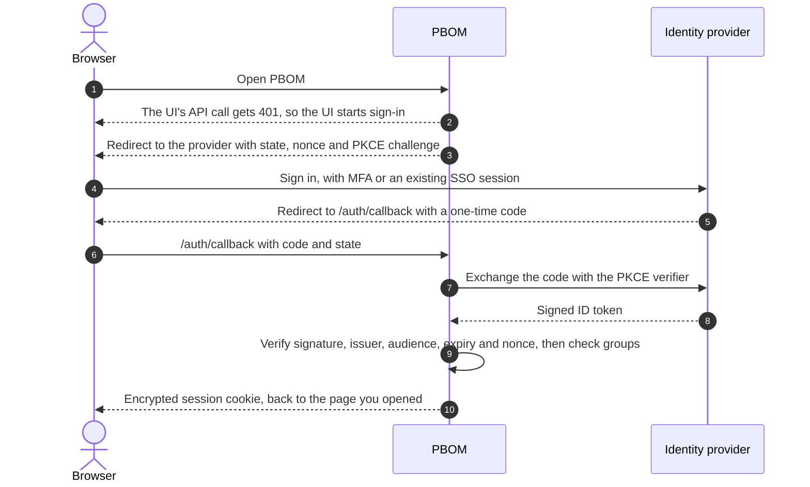
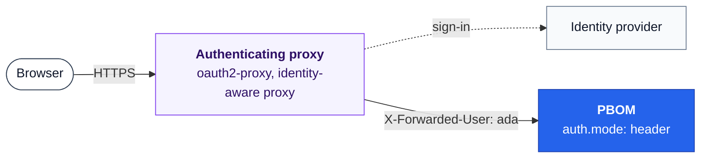

# Authentication

By default PBOM has no sign-in: anyone who can reach it can read the platform,
its inventories and its release notes. PBOM never writes to a cluster, but
before you share the UI, choose who may open it.

| Mode | Who gets in | Choose it when |
| --- | --- | --- |
| `none` (default) | Anyone who can reach PBOM | It stays on `127.0.0.1` or a private network |
| [`oidc`](#openid-connect-sign-in) | Users your identity provider signs in, optionally only members of some groups | You have Microsoft Entra ID, Okta, Keycloak, Dex, Google or another OpenID Connect provider |
| [`header`](#authenticating-proxy) | Users an authenticating proxy in front of PBOM lets through | You already run oauth2-proxy or an identity-aware proxy |

Every signed-in user sees everything. Roles and per-environment visibility are
planned in [#40](https://github.com/ravibagri5/platform-bom/issues/40).

## OpenID Connect sign-in

PBOM signs users in with the authorization code flow and PKCE, the standard
for web applications. It needs no database: the session is an encrypted
cookie.



### 1. Register PBOM with your provider

Create an application, also called a client, of type *web application* with:

| Setting | Value |
| --- | --- |
| Redirect URI | `https://pbom.example.com/auth/callback` |
| Post-logout redirect URI | `https://pbom.example.com/` |
| Scopes | `openid`, `profile`, `email` |

Note the issuer URL, the client ID and the client secret. A public client
without a secret also works, because PKCE protects the code.

| Provider | Issuer | Groups for `allowedGroups` |
| --- | --- | --- |
| Microsoft Entra ID | `https://login.microsoftonline.com/<tenant ID>/v2.0` | Add a groups claim under *Token configuration*; values are group object IDs. Or set **Assignment required** on the enterprise application to limit sign-in. |
| Okta | `https://<org>.okta.com/oauth2/default` | Add a `groups` claim to the ID token in the authorization server. |
| Keycloak | `https://keycloak.example.com/realms/<realm>` | Add a *Group Membership* mapper with *Full group path* off to the client. |
| Dex | The `issuer` in your Dex configuration | Add `groups` to `scopes`. |
| Google | `https://accounts.google.com` | No groups claim. Limit sign-in with an *Internal* OAuth consent screen. |

### 2. Store the secrets

Create one Secret with the client secret and a random key that encrypts
sessions. With the key, users stay signed in when the pod restarts:

```sh
kubectl -n platform-bom create secret generic pbom-oidc \
  --from-literal=client-secret='<client secret>' \
  --from-literal=session-secret="$(openssl rand -base64 32)"
```

### 3. Turn it on

Put the settings in a Helm values file, with an
[Ingress](../charts/platform-bom/README.md#optional-ingress-and-tls) for the
same hostname as the redirect URI:

```yaml
auth:
  mode: oidc
  oidc:
    issuer: https://login.microsoftonline.com/<tenant ID>/v2.0
    clientId: <application ID>
    clientSecret:
      name: pbom-oidc
    redirectURL: https://pbom.example.com/auth/callback
    allowedGroups: [<group object ID>]   # optional
  sessionSecret:
    name: pbom-oidc
```

```sh
helm upgrade pbom oci://ghcr.io/ravibagri5/charts/platform-bom -n platform-bom \
  --reset-then-reuse-values -f auth-values.yaml --wait
```

Open `https://pbom.example.com`. PBOM sends you to the provider, then back to
the page you opened. Your name and **Sign out** appear in the top bar.
Signing out ends the PBOM session and, if the provider supports it, the
provider session too.

### Without Kubernetes

```sh
export PBOM_OIDC_CLIENT_SECRET='<client secret>'
export PBOM_SESSION_SECRET="$(openssl rand -base64 32)"
pbom serve --auth oidc \
  --oidc-issuer https://keycloak.example.com/realms/platform \
  --oidc-client-id pbom \
  --oidc-redirect-url http://127.0.0.1:8080/auth/callback
```

## Authenticating proxy

If a proxy such as [oauth2-proxy](https://oauth2-proxy.github.io/oauth2-proxy/)
already signs users in, PBOM can trust the user name it passes on.



```yaml
auth:
  mode: header
  header:
    name: X-Forwarded-User        # X-Auth-Request-User with nginx auth_request
    trustedProxies: [10.0.0.0/8]  # where the proxy connects from
```

Any client that reaches PBOM directly could set the header itself. Set
`trustedProxies` to the addresses the proxy connects from, such as your pod
network, or allow only the proxy with a NetworkPolicy. Requests without the
header are refused.

## Security

- **Standard flow.** Authorization code with PKCE (S256); `state` and `nonce`
  are checked in constant time; the ID token's signature, issuer, audience and
  expiry are verified with [go-oidc](https://github.com/coreos/go-oidc).
- **Sessions.** The session cookie holds only your name and email, encrypted
  and authenticated with AES-GCM. It is `HttpOnly` and `SameSite=Lax`, and
  `Secure` when the redirect URL uses HTTPS. It lasts `sessionDuration`
  (default 12 hours).
- **Redirects** after sign-in only go to paths on PBOM itself. Sign-out accepts
  only `POST` requests from PBOM's own origin.
- **Public paths** are `/healthz`, the sign-in endpoints under `/auth/` and the
  UI's static files, which contain no platform data. Every API call needs a
  session and gets `401` without one; the UI then starts the sign-in and
  returns to the page you opened.
- **Serve over HTTPS** in production, so cookies and tokens never cross the
  network in clear text.

## Reference

| `pbom serve` flag | Chart value | Default |
| --- | --- | --- |
| `--auth` | `auth.mode` | `none` |
| `--auth-header` | `auth.header.name` | `X-Forwarded-User` |
| `--auth-trusted-proxies` | `auth.header.trustedProxies` | Any client |
| `--oidc-issuer` | `auth.oidc.issuer` | Required for `oidc` |
| `--oidc-client-id` | `auth.oidc.clientId` | Required for `oidc` |
| `--oidc-redirect-url` | `auth.oidc.redirectURL` | Required for `oidc`; ends in `/auth/callback` |
| `--oidc-scopes` | `auth.oidc.scopes` | `openid,profile,email` |
| `--oidc-username-claim` | `auth.oidc.usernameClaim` | `name`, then `preferred_username`, `email`, `sub` |
| `--oidc-groups-claim` | `auth.oidc.groupsClaim` | `groups` |
| `--oidc-allowed-groups` | `auth.oidc.allowedGroups` | Anyone the provider signs in |
| `--session-duration` | `auth.sessionDuration` | `12h` |
| `PBOM_OIDC_CLIENT_SECRET` | `auth.oidc.clientSecret` | None (public client) |
| `PBOM_SESSION_SECRET` | `auth.sessionSecret` | New random key at every start |

## Troubleshooting

| Symptom | Fix |
| --- | --- |
| The provider shows *redirect URI mismatch* | Register exactly the `redirectURL`, including scheme, host and `/auth/callback`. |
| *The sign-in expired or was started in another browser* | The sign-in took longer than 10 minutes, or cookies are blocked. Start again. |
| *You are not a member of a group allowed to use PBOM* | Check that the ID token has the `groupsClaim` claim with the values in `allowedGroups`. |
| *The identity provider is unavailable* | The pod cannot reach the issuer. Check egress and that `<issuer>/.well-known/openid-configuration` loads. |
| Signed out after every deployment | Set `auth.sessionSecret`. |
| `403` in `header` mode | The request did not come from an address in `trustedProxies`. |
