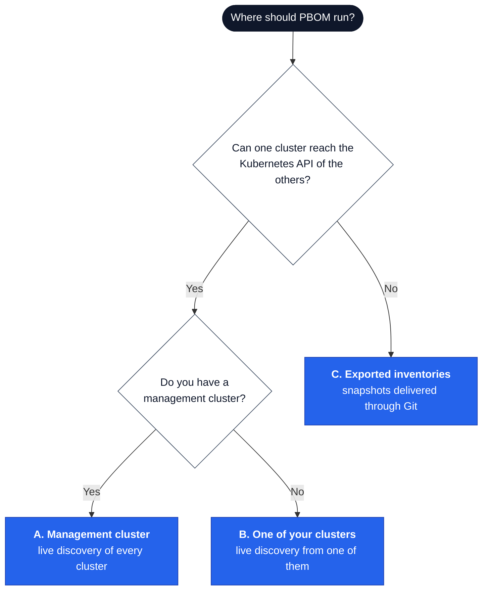
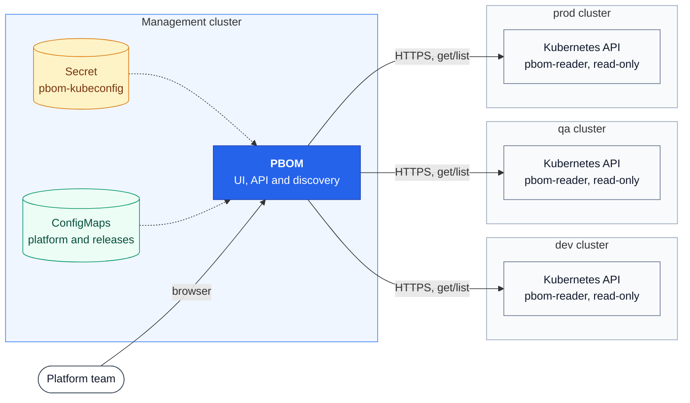
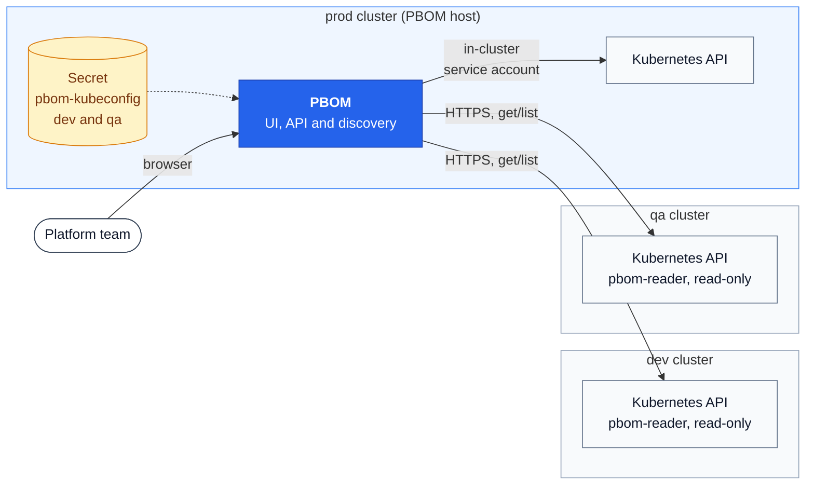
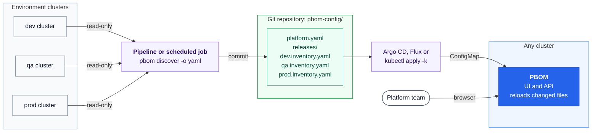

# Multi-cluster setup

Most platforms run in several environments, such as dev, QA and prod, and each
environment is usually its own Kubernetes cluster. Run **one PBOM** that sees
all of them. That instance shows every environment side by side on the same
page: which release each runs, what drifted and what to upgrade next.

PBOM instances do not share data. If you install PBOM separately in every
cluster, each one sees only its own cluster and cannot compare it with the
others.

How the central PBOM gets data from the other clusters depends on your network:

| Setup | Where PBOM runs | How it reads the other clusters | Choose it when |
| --- | --- | --- | --- |
| [A. Management cluster](#a-management-cluster) | A dedicated management or tooling cluster | Live, with a read-only token per cluster | You already have a management cluster |
| [B. One of your clusters](#b-one-of-your-clusters) | One of the environment clusters | Its own cluster directly; the others with a read-only token | There is no management cluster, but clusters can reach each other's API |
| [C. Exported inventories](#c-exported-inventories) | Anywhere | Snapshot files that a pipeline exports and commits to Git | Clusters cannot reach each other's API |



One `platform.yaml` can use more than one setup. For example, it can discover
dev and prod live and read an exported inventory for an isolated edge cluster.

## A. Management cluster

PBOM runs next to your other platform tooling, such as Argo CD or Crossplane.
It reads every environment cluster through its API server, using a read-only
token for each cluster.



Set it up with the [steps for live discovery](#set-up-live-discovery-a-and-b).
In `platform.yaml`, every environment uses the kubeconfig:

```yaml
  environments:
    - name: dev
      kubeconfig: /kubeconfig/config
      kubeContext: dev
      targetRelease: "1.2.0"
    - name: qa
      kubeconfig: /kubeconfig/config
      kubeContext: qa
      targetRelease: "1.2.0"
    - name: prod
      kubeconfig: /kubeconfig/config
      kubeContext: prod
      targetRelease: "1.1.0"
```

## B. One of your clusters

Without a management cluster, install PBOM in one of the environment clusters.
It reads the cluster it runs in directly, without a kubeconfig, and the other
clusters through the kubeconfig.



**Choose the most protected cluster as the host, usually prod.** A cluster that
holds the kubeconfig can read every other cluster. If PBOM ran in dev, anyone
with access to dev could read prod. Hosting it in prod only gives prod access
to the less protected clusters.

Set it up with the [steps for live discovery](#set-up-live-discovery-a-and-b),
leaving out the host cluster. In `platform.yaml`, the host environment uses
`inCluster: true`:

```yaml
  environments:
    - name: dev
      kubeconfig: /kubeconfig/config
      kubeContext: dev
      targetRelease: "1.2.0"
    - name: qa
      kubeconfig: /kubeconfig/config
      kubeContext: qa
      targetRelease: "1.2.0"
    - name: prod
      inCluster: true
      targetRelease: "1.1.0"
```

## C. Exported inventories

Use this when no cluster may reach another cluster's API, for example an
air-gapped or strictly firewalled prod. A pipeline that already has access to
each cluster exports what that cluster runs to a file. The files go to Git,
and PBOM reads them from there. PBOM itself needs no access to those clusters.



1. **Export each cluster** from a machine or pipeline that can reach it:

   ```sh
   pbom discover --context prod-admin --env prod -o yaml > pbom-config/prod.inventory.yaml
   ```

2. **Reference the files** in `platform.yaml`:

   ```yaml
     environments:
       - name: prod
         inventoryFile: prod.inventory.yaml
         targetRelease: "1.1.0"
   ```

3. **Apply** as in [getting started](getting-started.md#5-apply-the-yaml).
   `pbom kustomize pbom-config` adds the inventory files to the platform
   ConfigMap:

   ```sh
   pbom kustomize pbom-config
   kubectl apply -k pbom-config
   ```

PBOM reloads changed inventories without a restart. The data is only as recent
as the last export, so run step 1 on a schedule or after every deployment. A
ConfigMap holds at most 1 MiB, which is enough for many inventories.

PBOM does not include the export job. Use any scheduler that can run `pbom`
with access to the cluster, such as a CI pipeline.

## Set up live discovery (A and B)

You need the files from [getting started](getting-started.md), steps 1 to 5,
installed in the cluster that hosts PBOM, and chart 0.6.0 or newer. The
`pbom-config` directory must already be applied.

**1. Create a read-only account in each cluster PBOM should reach.** Run the
script once per cluster, with your admin context for that cluster and the
name PBOM should use:

```sh
curl -fsSLO https://raw.githubusercontent.com/ravibagri5/platform-bom/main/hack/remote-kubeconfig.sh
sh remote-kubeconfig.sh my-dev-admin dev
sh remote-kubeconfig.sh my-qa-admin qa
sh remote-kubeconfig.sh my-prod-admin prod     # skip the host cluster in setup B
```

In each cluster, the script applies
[deploy/remote-reader.yaml](../deploy/remote-reader.yaml): a `pbom-reader`
service account that can only `get` and `list` nodes, workloads, Crossplane
packages and Secrets, the last for Helm metadata. It then adds a context with
that account's token to the file `pbom-kubeconfig`.

**2. Store the kubeconfig as a Secret** in the cluster that hosts PBOM, then
delete the local copy:

```sh
kubectl -n platform-bom create secret generic pbom-kubeconfig --from-file=config=pbom-kubeconfig
rm pbom-kubeconfig
```

**3. Mount it** into PBOM:

```sh
helm upgrade pbom oci://ghcr.io/ravibagri5/charts/platform-bom -n platform-bom \
  --reset-then-reuse-values --set kubeconfigSecret.name=pbom-kubeconfig --wait
```

The Secret appears in the pod as `/kubeconfig/config`.

**4. Add the environments** to `pbom-config/platform.yaml` as shown in
[A](#a-management-cluster) or [B](#b-one-of-your-clusters), then apply:

```sh
kubectl apply -k pbom-config
```

The **Environments** page lists every cluster within one to two minutes. The
kubeconfig is never committed to Git: it lives only in the Secret.

## Security

- **Read-only.** Every account PBOM uses can only `get` and `list`. PBOM never
  changes a cluster.
- **Helm metadata is in Secrets.** Helm stores release data in Secrets, and
  Kubernetes cannot limit access to only those Secrets. Remove the `secrets`
  rule from `remote-reader.yaml` to skip Helm discovery in a cluster. PBOM
  still reads images, Crossplane packages and the cluster version there.
- **Revoke or rotate** a cluster's access by deleting its token. Then run the
  script again and update the Secret:

  ```sh
  kubectl --context my-prod-admin -n platform-bom delete secret pbom-reader-token
  sh remote-kubeconfig.sh my-prod-admin prod
  kubectl -n platform-bom create secret generic pbom-kubeconfig --from-file=config=pbom-kubeconfig \
    --dry-run=client -o yaml | kubectl apply -f -
  ```

  PBOM uses the new token at its next discovery, without a restart. When
  rotating, put every context back into `pbom-kubeconfig` first, because the
  file replaces the whole Secret.
- **The UI has no login.** Keep it private or put it behind an authenticating
  proxy, as described in the [chart README](../charts/platform-bom/README.md#optional-ingress-and-tls).

## Troubleshooting

| Symptom on the Environments page | Fix |
| --- | --- |
| `dial tcp ... i/o timeout` or `connection refused` | The PBOM pod cannot reach that API server. Allow the traffic, or choose [C](#c-exported-inventories) for that cluster. |
| Server is `127.0.0.1` or a private name | The address in your admin context only works on your machine. Re-run the script with the address the pod can reach, for example `SERVER=https://10.0.0.12:6443 sh remote-kubeconfig.sh my-dev-admin dev`. |
| `exec: executable ... not found` (`kubelogin`, `aws`, `gke-gcloud-auth-plugin`) | The kubeconfig uses a cloud login plugin, which the image does not include. Use the script's token-based kubeconfig. |
| `Unauthorized` | The token was deleted. Rotate it as described above. |
| `context "x" does not exist` | `kubeContext` in `platform.yaml` must match a context name you gave the script. |
